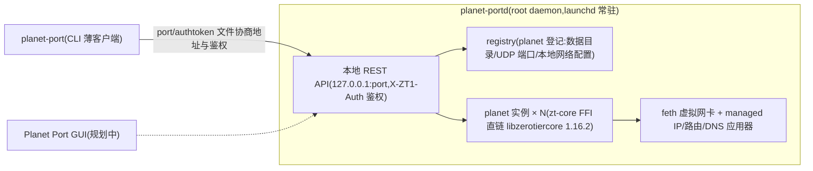

# Planet Port Desktop 🪐

**Planet Port Desktop** 是一款开源的桌面端 ZeroTier 客户端，基于 ZeroTier 1.16 官方核心（Rust FFI 直链）打造。它让你在 Mac 上轻松完成异地组网与虚拟局域网管理：多 Planet 并存（官方 + 自建私有 Planet），多网络同时连接，默认路由与 DNS 全自由掌控。采用「特权 daemon + 薄客户端」架构：`planet-portd` 守护进程持核心与虚拟网卡，`planet-port` CLI 与规划中的 GUI 都是纯 API 客户端，GUI 不开、隧道照跑。

> 非官方客户端，与 ZeroTier, Inc. 无隶属关系。

## 当前状态与路线图

| 平台 | CLI | GUI |
|---|---|---|
| macOS | ✅ | 📐 |
| Linux | 🚧 | 📐 |
| Windows | 🚧 | 📐 |

✅ 可用 · 🚧 进行中 · 📐 规划中

CLI 与 GUI 都是 `planet-portd` daemon 的薄客户端；GUI 选型 Tauri 2（托盘常驻），daemon + CLI 已覆盖全部功能，GUI 不开、隧道照跑。

### 系统支持与最低版本

产物形态参考 zerotier-one 官方分发（预编译 tar.gz 二进制 + 安装脚本，后续按系统补 deb / MSI 等安装包）：

| 系统 | 产物类型 | 完成程度 | 最低系统版本 |
|---|---|---|---|
| macOS（Apple Silicon / Intel） | tar.gz + 安装脚本 | ✅ 已发布可用（launchd 服务、feth 数据面、DNS 托管完整） | macOS 12+ |
| Ubuntu / Linux Mint 等 Debian 系 | tar.gz + 安装脚本（后续 deb） | 🚧 适配中：数据面已通（Ubuntu 24.04 实机验证多 planet 上线、join/netconf/路由、跨节点连通与 LAN 直连）；服务层（launchd→systemd）与安装脚本待适配 | Ubuntu 20.04+ / Mint 20+ |
| Debian | 同上（与 Ubuntu 共用 Linux 产物） | 🚧 同上 | Debian 11+ |
| Windows | zip + 安装脚本（后续 MSI） | 🚧 实现完成：wintun 数据面、SCM 服务化、CLI 全命令、DNS NRPT、install.ps1 / 离线 zip 安装链路；Win11 实机安装级验收进行中，Win10 纸面支持未实测 | Windows 10+ |
| Termux（Android） | 待定 | 📐 待定（zerotier-one 官方亦不发布 Termux 包，仅社区仓库有） | 待定 |
| 其它（FreeBSD / RHEL 系等） | 待定 | 📐 待定 | 待定 |

> 最低版本说明：Linux 系以 Ubuntu 20.04 为构建基线（glibc 向后兼容，20.04 构建的产物可跑更新版本）；macOS 12+ 为设计目标，当前仅在 macOS 26（Apple Silicon）实测；Windows 10+ 为纸面下限（按支持面收敛），当前仅在 Windows 11 实测。

架构与可行性结论见 [docs/2026-10-28-desktop-port-feasibility.md](docs/2026-10-28-desktop-port-feasibility.md) ，CLI/API 设计见 [docs/superpowers/specs/2026-10-28-cli-api-design.md](docs/superpowers/specs/2026-10-28-cli-api-design.md) 。

## 特色

- **多 Planet 管理**：官方与多份私有 Planet 同机并存，本地文件 / URL 导入，别名、启停、导出、临时分享链接一站管理
- **多网络同时连接**：每 planet 独立身份与数据目录；join / leave、跨 planet 聚合查询（网络 / peers / moons）
- **默认路由与 DNS 自由掌控**：`routeViaZeroTier` 开关、`dnsMode=none|network|custom`，全部陈述式配置，脚本友好
- **Moon 支持**：orbit / deorbit / 导入 `.moon` 文件
- **身份模式**：`planet-port identity` 查看各 planet 身份绑定；`identity import` 导入官方 ZeroTier 身份（自动停禁官方服务，沿用原节点地址与网络成员资格）；`identity use <planet> global|own` 切换全局/独立身份绑定
- **服务化常驻**：launchd 一键安装，开机自启、崩溃自动拉起；SIGTERM 优雅退出（逐 planet 红线收尾，保留期望状态，`service start` 后自动恢复）；重启后自动 re-join 已加入网络
- **事件日志**：`events --follow` 按 ts 游标增量跟踪状态变更
- **多语言 CLI**：简中 / 繁中 / 英语，跟随系统语言自动选择（无需配置），语言文件可扩展

## 快速开始

> **系统要求**：macOS（Apple Silicon / Intel）；Windows（x86_64）安装见 [docs/install.md](docs/install.md) 的 Windows 章节。各系统支持程度与最低版本见上方「系统支持与最低版本」。

```bash
# 一条命令:下载二进制 + 装软链 + 装 launchd 服务并启动
curl -fsSL https://raw.githubusercontent.com/planet-port/planet-port-desktop/main/scripts/install.sh | sudo bash

# 指定版本 / 只装二进制不装服务
curl -fsSL https://raw.githubusercontent.com/planet-port/planet-port-desktop/main/scripts/install.sh | sudo bash -s -- v0.1.1 --no-service

# 卸载(数据目录默认保留;--purge 彻底清除)
sudo bash scripts/uninstall.sh [--purge]
```

二进制落在 `/Library/Application Support/planet-portd/bin/`，`/usr/local/bin/planet-port` 为软链；升级重跑安装脚本即可（停止前记录运行中的 planet，装完自动拉回）。

首次使用：

```bash
planet-port add ./planet.mine --name mine     # 导入私有 planet 并立即上线(也可用官方 planet)
eval $(planet-port use mine)                   # 设默认 planet(本 shell)
planet-port join 5cf54f181554090f              # 加入网络(16 位 ID)
planet-port listnetworks                       # 等控制器在 ZeroTier Central 授权后状态变 RUNNING
planet-port info                               # 聚合状态总览
```

GUI 挂了 / 不开不影响隧道——daemon 独立常驻，全部功能均可经 CLI 完成。

## 核心用法

### 服务管理

```bash
sudo planet-port service install     # 拷贝二进制 + 写 LaunchDaemon + bootstrap(开机自启/崩溃拉起)
sudo planet-port service start       # 拉起,并按期望状态自动恢复 planet
planet-port service status           # 无需 root 查看状态
sudo planet-port service stop        # SIGTERM 优雅退出;保留期望状态,start 后恢复
```

### planet 定位与命令参考

多 planet 并存时，变更类命令（join / leave / set / orbit / deorbit / dump / moon import）按定位链落到恰好一个 planet：显式 `--planet` > 环境变量 `PLANET_PORT_PLANET`（`eval $(planet-port use <x>)` 设置）> 唯一 running 自动选中 > 交互式 TTY 弹单选列表（非交互报 `409` 列候选，不猜）；查询类命令默认聚合展示，`--planet` 为过滤。

完整 CLI 规范（全局选项、地址与鉴权协商、交互式多选、全部命令、行为说明、退出码）见 [COMMANDS.md](COMMANDS.md) 。

## 架构



- **特权收敛**：提权只有一次 `service install`；daemon 以 root 建 feth 网卡、装路由，CLI / GUI 永不提权（ZeroTier / Tailscale 同款模式）
- **Planet 隔离**：每 planet 一个 zt-core Node 实例，独立身份、独立数据目录、独立 UDP 端口
- **活性协商**：daemon 启动写 `port` 文件（实际监听端口）与 `authtoken.secret`；port 文件存在即活性信号，daemon 退出时最后删除它。CLI 未显式指定 URL 时靠它协商地址
- **自动恢复**：registry 的 `running` 是**期望状态**——`service stop`（SIGTERM 优雅退出）保留它，daemon 启动时自动拉起全部期望运行的 planet 并按登记的本地网络配置逐网络 re-join（zt-core 的 `networks.d/<nwid>.conf` 只是 netconf 缓存，不承载成员关系）；用户显式 `planet-port stop` 落 `running=false`，重启后不拉起

### 目录

| crate | 说明 |
|---|---|
| `crates/daemon`(planet-portd) | 真实 daemon:内嵌 zt-core,管理多 planet 实例 |
| `crates/cli`(planet-port) | CLI 薄客户端 |
| `crates/api`(planet-port-api) | REST 契约类型与端点构造(CLI 与 daemon 共用) |
| `crates/zt-sys` / `crates/zt-core` | ZeroTier 1.16.2 核心 FFI(-sys 绑定 + safe wrapper) |
| `crates/pocs` | 可行性验证代码 |

## 开发

### 源码构建与前台调试

```bash
cargo build --workspace
# 前台运行需 sudo:实例要建 feth 网卡、装路由
sudo ./target/debug/planet-portd --config-dir "$HOME/Library/Application Support/planet-portd"
```

`--config-dir` 缺省时按三级解析：env `PLANET_PORT_CONFIG_DIR` → `/Library/Application Support/planet-portd`（已存在时）→ `~/Library/Application Support/planet-portd`。同一 config 目录内有 flock 单实例守卫（`daemon.lock`）。

### 环境变量与请求行为

CLI 侧环境变量（`PLANET_PORT_URL` / `PLANET_PORT_TOKEN` / `PLANET_PORT_CONFIG_DIR` / `PLANET_PORT_PLANET`）、API 地址与鉴权协商、请求超时说明见 [COMMANDS.md](COMMANDS.md) 。

### 回归验证

CLI 手工回归清单（对 planet-portd 实测的基准）见 [docs/2026-10-29-cli-regression-checklist.md](docs/2026-10-29-cli-regression-checklist.md) 。

## 致谢

- [ZeroTier](https://github.com/zerotier/ZeroTierOne) — 网络核心

## 捐赠

如果 Planet Port Desktop 帮到了你，欢迎请作者喝杯咖啡 ☕

**BTC**（Taproot）

```
bc1p5426677uuazuvfy9fptmczv4zwv550qlu9umw9jyptw5q7ln420qe03ae6
```

**ETH**（Ethereum）

```
0xbaa7a263a95bddb2ff364d1c47e385ed9f54a66a
```

**SOL**（Solana）

```
CFjZhq1dYdQCFKgkhbBwQEzg21WKwoNAm9KZ9uk2nJyf
```
